# Java 기반 다중 사용자 채팅 프로그램 (ChatProject)

> Java Socket·Swing·MySQL 기반 학습 프로젝트  
> **개발 기간:** 2026년 9월 ~ 12월(진행 중) · **최신 기록:** 11주차(2026년 11월)

## 프로젝트 소개

학교 Java 프로그래밍 과제로 시작하여, 기존 채팅 예제를 분석하고 기능을 직접 수정·확장하며 Java를 학습하는 프로젝트입니다. 회원 관리와 데이터베이스 연동을 시작으로 다중 사용자 채팅, 메시지 저장·검색, Swing 채팅창, 이모티콘 및 이미지 갤러리까지 단계적으로 구현했습니다. 기능별로 서버와 클라이언트를 실행하고 MySQL의 저장 결과를 비교하며 테스트했습니다.

이 저장소는 **로컬 학습용** 프로젝트입니다. 실제 서비스 배포를 위한 보안 검증이나 설치 자동화까지 완료한 상태는 아닙니다.

## 사용 기술

| 구분 | 기술 |
| --- | --- |
| 개발 언어·화면 | Java, Swing |
| 개발 환경 | Eclipse, Windows |
| 네트워크 | Java Socket, 다중 클라이언트 처리 |
| 데이터베이스 | MySQL (`chatdb`), JDBC, SQL |
| 외부 API | Open-Meteo 날씨 API |
| 개발 방식 | 주차별 기능 구현 → 실행 → 오류 수정 → DB 확인 |

## 주차별 개발 현황

| 주차 | 구현·테스트한 기능 |
| --- | --- |
| 3주차 | 서버/클라이언트 예제 분석, 로컬 연결 및 초기 ERD |
| 4주차 | MySQL `users` 테이블, JDBC 저장·조회 |
| 5주차 | 아이디 중복 확인, 비밀번호 유효성 검사 |
| 6주차 | 프로필 이미지·주소·닉네임·비밀번호 변경 |
| 7주차 | 보안 질문 기반 계정 복구, Open-Meteo 날씨 조회 |
| 8주차 | 1:1·그룹 채팅방, 채팅방 목록, 귓속말, 초대·수락 |
| **9주차** | **`ChatProjectStart` 통합 시작 메뉴, 회원가입→로그인→로비 연결, 프로필 설정·채팅방 생성 통합 테스트** |
| **10주차** | **채팅 메시지 DB 저장·이전 기록 30건 조회·키워드 검색, Swing 채팅창의 배경색·글꼴·크기 변경, 유니코드 이모티콘** |
| **11주차** | **PNG/GIF 이모티콘 6종 DB 저장·조회, 파일 전송, 이미지 갤러리 저장·조회·확대, 채팅방 재입장 시 이미지 복원** |

자세한 과정, 오류와 검증 결과는 [학습 기록](LEARNING_LOG.md)에 정리했습니다.

## 주요 기능과 실행 결과

### 0. 기초 기능: 회원 및 채팅방 관리 (3~8주차)

회원 아이디 중복 확인, 채팅방 생성·조회, 초대와 수락 등 초기에 구현한 기능입니다. 다음 화면은 기존에 정리한 실행 증빙입니다.

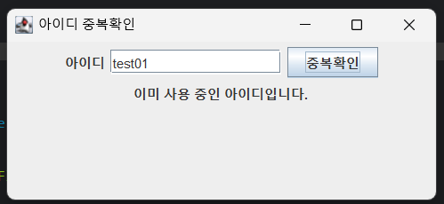

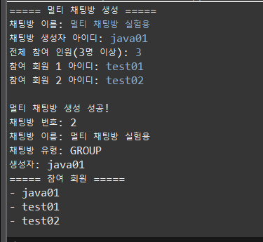

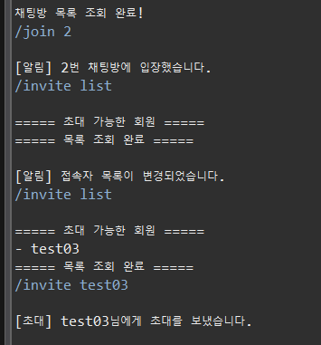

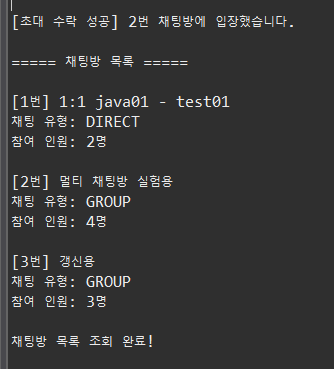

### 1. 통합 실행 및 채팅방 관리 (9주차)

회원가입·로그인·아이디/비밀번호 찾기를 시작 메뉴에 통합했습니다. 로그인 후 로비에서 날씨·채팅방 목록을 확인하고, `profile`·`settings`·`/create` 명령으로 프로필 수정과 채팅방 생성을 이어서 실행할 수 있도록 연결했습니다.

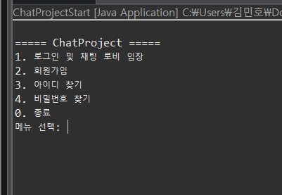

### 2. 채팅 메시지 DB 저장·검색 (10주차)

`chat_message` 테이블에 발신자, 채팅방, 내용, 전송 시각을 저장합니다. 채팅방에 다시 입장하면 최근 메시지 최대 30건을 조회하며, `/search 검색어`로 현재 채팅방의 대화를 검색할 수 있습니다.

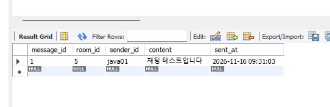

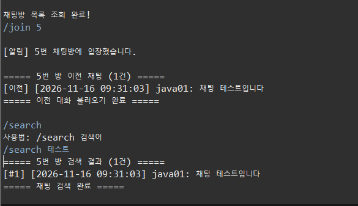

### 3. Java Swing 채팅창 (10주차)

배경색, 글꼴, 글자 크기를 변경할 수 있는 채팅창을 구현했습니다. 초기 유니코드 이모티콘은 일부 글꼴에서 네모로 표시되어 이모지를 지원하는 글꼴로 변경해 테스트했습니다.

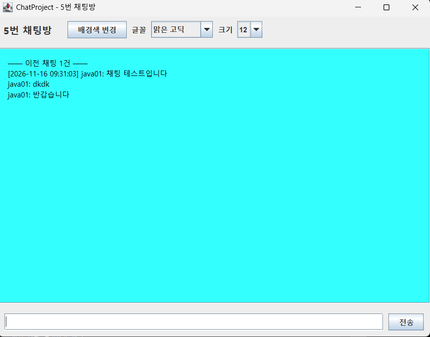

### 4. PNG/GIF 이모티콘 (11주차)

`emoticon_assets`에 PNG 4종과 GIF 2종의 원본을 저장하고 `EmoticonDbRepository`로 조회하도록 연결했습니다. MySQL에서도 총 6건의 데이터가 기록된 것을 확인했습니다.

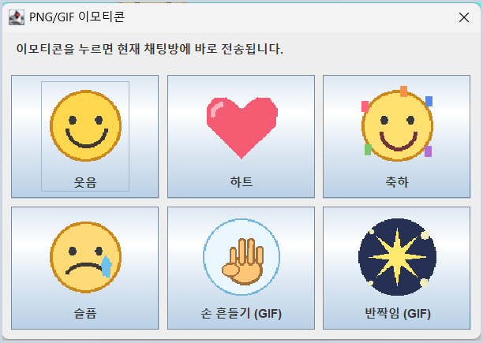

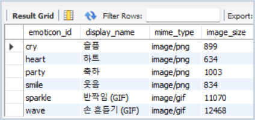

### 5. 이미지 전송·갤러리·복원 (11주차)

`chat_images`에 파일명, 이미지 형식, 원본 데이터(`LONGBLOB`), 업로드 시각을 저장합니다. 채팅방별 갤러리에서 이미지를 목록으로 보고 확대할 수 있습니다. 6번 채팅방의 JPEG 2건을 저장·조회했습니다. 이미지 ID를 `chat_message`와 연결해 방에 다시 들어왔을 때 이전 이미지의 미리보기가 복원되는 것도 실행으로 확인했습니다(재입장 화면 캡처는 아직 추가 예정).

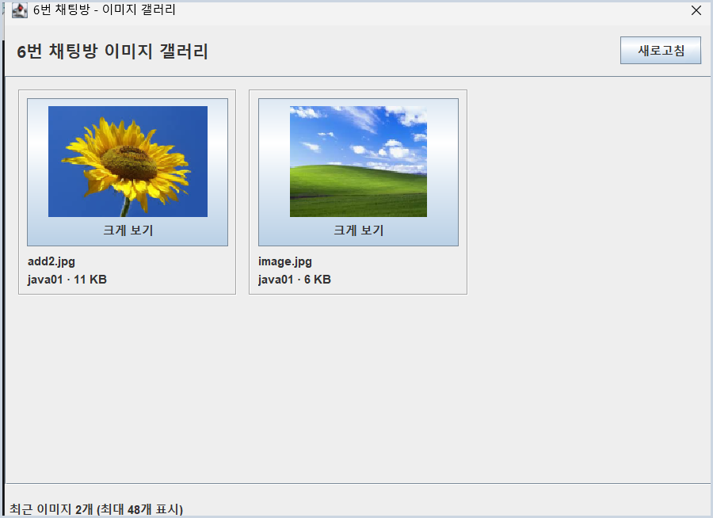

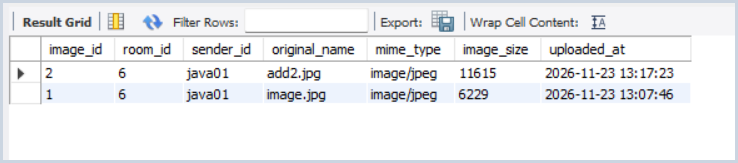

파일 전송 시 선택 가능한 최대 크기는 20MB이며, **갤러리에 자동 DB 저장되는 대상은 5MB 이하 PNG·JPG·GIF 이미지**입니다. 일반 문서·동영상 원본까지 DB에 영구 저장하는 것은 아닙니다.

## 데이터베이스 확장

초기 `users` 중심 설계에서 `chat_rooms`·`room_members`를 추가하고, 일정 관리용 `schedules`, 채팅 메시지용 `chat_message`, 이모티콘용 `emoticon_assets`, 이미지용 `chat_images` 등으로 확장했습니다.

11주차의 `chat_images.room_id`·`sender_id`는 애플리케이션에서 참조 관계로 사용하지만, **11주차 SQL에서는 실제 FOREIGN KEY 제약조건을 선언하지 않았습니다.** ERD의 관계선과 실제 DB 제약조건은 구분합니다.

## 추가 학습·확장 기능

기존 수업 기능 외에 메모장, 일정 관리, 그림판, 틱택토 등의 기능을 연습하고 채팅 클라이언트 명령과 연결하는 작업도 진행했습니다. 또한 금칙어 처리, 멘션, 답장 등 메시지 편의 기능을 확장했습니다. **각 기능의 최종 테스트 증빙과 화면 자료는 정리 중이며, 구현 완료 범위는 해당 소스 코드와 테스트 결과를 기준으로 확인해 주세요.**

## 문제 해결 경험

- **MySQL 연동 오류:** 연결 정보·서비스 설정·재설치를 반복 확인한 뒤, 컴퓨터 이름에 포함된 한글의 영향을 발견하고 영문 이름으로 변경하여 정상 연결을 확인했습니다.
- **환경변수 전달 오류(9주차):** 클라이언트에서 `CHAT_DB_PASSWORD`가 전달되지 않아 DB 접속이 실패했습니다. Eclipse 실행 설정의 환경변수를 수정하여 해결했습니다.
- **이모티콘 표시 문제(10주차):** 유니코드 이모티콘이 일부 폰트에서 네모로 표시되는 현상을 글꼴 교체로 해결했습니다.
- **이미지 데이터 보존(11주차):** 파일 전달과 DB 원본 저장을 분리하고, 이미지 ID를 메시지 기록과 연결해 갤러리 조회와 과거 이미지 복원을 구현했습니다.

## 실행 및 공개 범위 안내

- 로컬 MySQL `chatdb`, JDBC 드라이버, Eclipse/Java 실행 환경이 필요합니다. DB 초기화 스크립트와 실행 환경 설정은 추가 정리가 필요합니다.
- 비밀번호는 코드에 직접 기록하지 않고 `CHAT_DB_PASSWORD` 환경변수에서 읽도록 설정했습니다.
- 학습용 구현이며 서버 측 인증 구조, 운영 환경 보안, 파일 업로드 검증 등은 추가 보완이 필요합니다.
- 기존 외부 예제의 구조를 참고한 학습 프로젝트이며, 예제 전체를 처음부터 직접 작성한 것으로 소개하지 않습니다.

## 다음 목표

12월까지 현재 기능의 통합 테스트를 진행하고, 추가 기능의 실행 화면 및 재입장 이미지 복원 캡처, DB 초기화 방법과 실행 가이드를 정리할 계획입니다.
