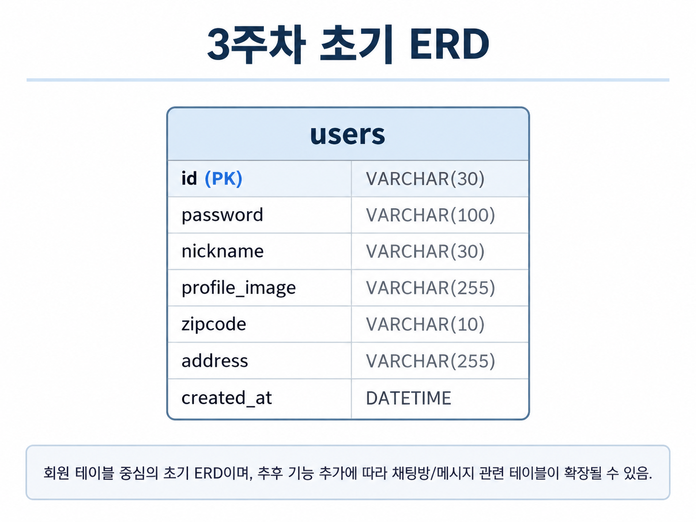
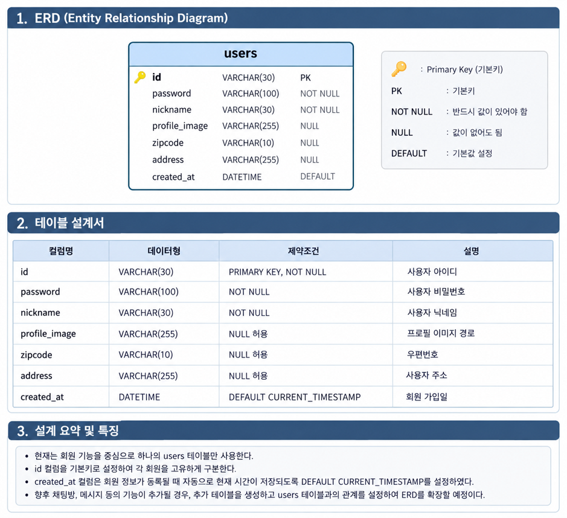

# Java 기반 다중 사용자 채팅 프로그램

**Java Socket과 MySQL을 활용한 채팅 프로그램 개발 프로젝트**

- 개발 기간: 2026년 9월 ~ 12월 (진행 중)
- 개발 형태: 개인 프로젝트 / 대학 Java 프로그래밍 수업 기반
- 개발 환경: Eclipse, Java, MySQL

## 1. 프로젝트 소개

Java를 공부하면서 서버와 클라이언트의 통신, 데이터베이스 연동, 사용자 관리가 실제 프로그램에서 어떻게 연결되는지 이해하기 위해 진행 중인 프로젝트입니다.

처음에는 기존 채팅 프로그램 예제를 분석하고 실행하는 것부터 시작했습니다. 이후 MySQL을 활용한 회원 관리, 프로필 관리, 채팅방 생성과 참여 등 다양한 기능을 추가하며 프로그램을 확장하고 있습니다.

학교 과제로 시작했지만 기능을 하나씩 구현하다 보니 더 완성도 높은 프로그램을 만들고 싶은 욕심이 생겼습니다. 현재는 부족하다고 느끼는 부분이나 추가하고 싶은 기능을 스스로 공부하고 적용하면서 Java에 대한 이해를 넓혀가고 있습니다.

12월까지 전체 기능을 완성하는 것을 목표로 개발하고 있습니다.

## 2. 사용 기술

| 구분 | 기술 |
|---|---|
| 개발 언어 | Java |
| 개발 도구 | Eclipse |
| 데이터베이스 | MySQL |
| 데이터베이스 연동 | JDBC, SQL |
| 네트워크 통신 | Java Socket |
| 동시 접속 처리 | Multi Thread |
| GUI | Java Swing |
| 외부 API | Open-Meteo 날씨 API |
| 운영체제 | Windows |

## 3. 주요 구현 기능

### 회원 관리
- 회원 정보 저장 및 조회
- 아이디 중복 확인
- 비밀번호 유효성 검사
- 닉네임 및 비밀번호 변경
- 주소 입력 및 수정
- 프로필 이미지 등록 및 변경
- 보안 질문을 이용한 계정 복구 기능

### 채팅 기능
- 서버와 클라이언트 간 Socket 통신
- 다중 사용자 접속
- 1:1 채팅방 생성
- 그룹 채팅방 생성
- 채팅방 목록 조회
- 채팅방 참여 및 초대
- 귓속말 기능
- 채팅방 참여자 정보 관리

### 추가 기능
- 메모장 기능
- 날씨 API를 활용한 날씨 정보 조회
- 사용자 프로필 관리

## 4. 데이터베이스 설계

MySQL을 활용하여 사용자 정보와 채팅방 정보를 관리했습니다.

### 주요 테이블

**users**
- 사용자 아이디
- 비밀번호
- 닉네임
- 프로필 이미지
- 주소 및 우편번호
- 계정 생성일

**chat_rooms**
- 채팅방 정보
- 채팅방 유형
- 채팅방 생성자

**room_members**
- 채팅방 참여자 정보
- 사용자와 채팅방의 관계 관리

처음에는 회원 정보를 저장하는 users 테이블만 사용했지만, 채팅방 기능을 구현하면서 chat_rooms와 room_members 테이블을 추가했습니다.

기능이 확장됨에 따라 데이터베이스 구조와 ERD도 함께 수정했습니다.

### 데이터베이스 설계 변화

**3주차 초기 ERD**

**4~5주차 ERD**

## 5. 주차별 개발 과정

| 주차 | 개발 내용 |
|---|---|
| 3주차 | 프로젝트 분석 및 초기 ERD 설계 |
| 4주차 | MySQL 데이터베이스 구성 및 JDBC 연동 |
| 5주차 | 아이디 중복 확인 및 비밀번호 유효성 검사 |
| 6주차 | 프로필 이미지, 주소 및 회원 정보 수정 |
| 7주차 | 계정 복구 및 날씨 API 연동 |
| 8주차 | 1:1·그룹 채팅방 생성, 참여 및 초대 기능 |

각 주차별 기능을 구현한 뒤 직접 실행해 보고, 오류가 발생하면 원인을 확인해 수정하는 방식으로 개발을 진행했습니다.

자세한 학습 과정은 LEARNING_LOG.md에 정리했습니다.

## 6. 현재 개발 상태

현재까지 회원 관리, 프로필 관리, 채팅방 생성 및 참여 등 기본 기능을 구현하고 테스트했습니다.

일부 추가 기능과 전체 프로그램 통합은 아직 진행 중입니다.

실제 서비스 수준의 보안 기능과 채팅 메시지의 데이터베이스 저장 및 조회 기능은 앞으로 보완할 예정입니다.

## 7. 향후 개발 계획

- 채팅 메시지 저장 및 조회 기능
- 채팅 검색 기능
- 이미지 및 파일 전송 기능
- 기존 기능 통합 및 오류 수정
- 사용자 편의 기능 추가
- 전체 프로그램 최종 테스트

12월까지 프로젝트를 완성하고 최종 테스트를 진행하는 것이 목표입니다.

## 8. 프로젝트를 통해 배운 점

처음에는 Java 문법을 배우는 데 집중했지만, 프로젝트를 진행하면서 서버 통신과 데이터베이스 연동 등 여러 기술이 함께 작동해야 하나의 프로그램이 완성된다는 것을 알게 되었습니다.

또한 새로운 기능을 추가할 때마다 기존에 알고 있던 내용만으로는 부족하다는 것을 느꼈고, 필요한 기술을 직접 찾아보고 적용하면서 공부하는 습관을 기르게 되었습니다.

앞으로도 기능을 단순히 구현하는 데 그치지 않고, 동작 원리를 이해하고 스스로 문제를 해결하는 개발자가 되고 싶습니다.

---

※ 본 프로젝트는 기존 채팅 예제를 참고하여 시작한 학습 프로젝트이며, 기능을 단계적으로 확장하고 있습니다.
